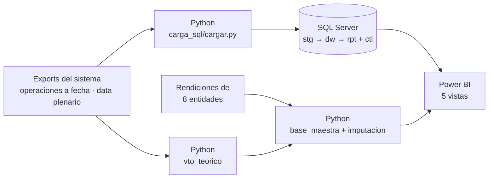
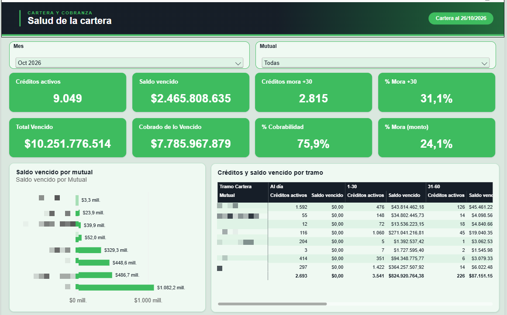
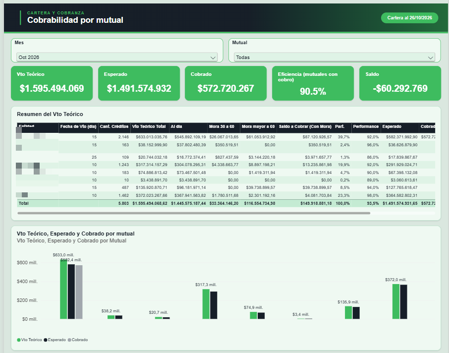
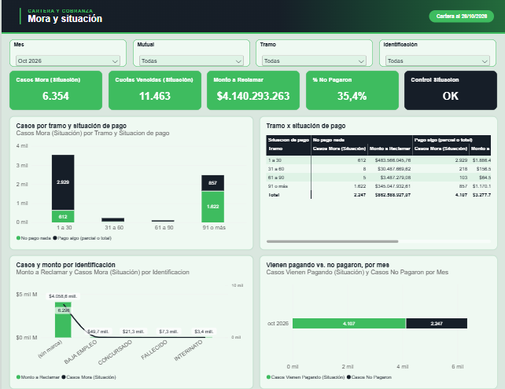
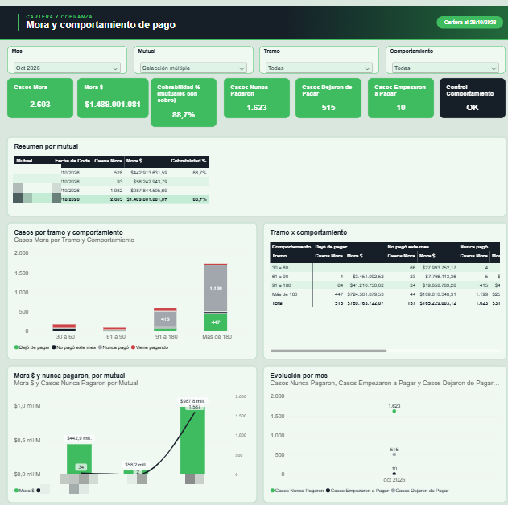
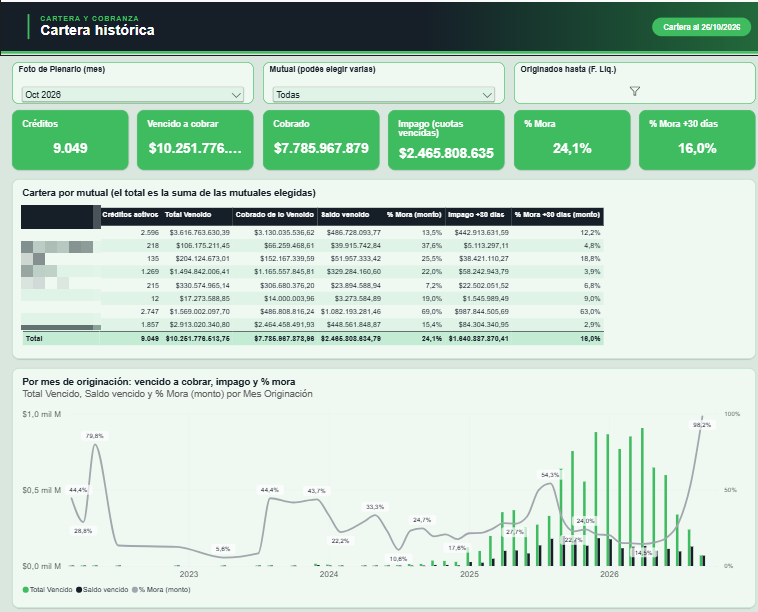

# Cartera y Cobranza — de Excel a SQL Server y Power BI

Proyecto independiente para una empresa del sector financiero que gestionaba toda su cartera de créditos y cobranzas en Excel: más de 15.000 créditos, 8 entidades que rinden cada una con su propio formato y decenas de archivos cruzados a mano cada mes.

> **Versión anonimizada para portfolio.** Los nombres de las entidades se reemplazaron por "Entidad 1…9". También se sacaron las rutas, los nombres de personas y los datos personales. Las capturas tienen los datos sensibles tapados.

## El problema

- Cada entidad informa lo que cobró en un formato distinto y con su propia numeración de créditos.
- El vencimiento teórico del mes se armaba a mano: 2 días de trabajo y 9 archivos.
- Responder "¿cuánta mora tenemos?" o "¿cómo se comporta la cartera originada hasta tal fecha?" llevaba días de cruces.

## La solución, en 4 capas

| Carpeta | Qué hace |
|---|---|
| `python/vto_teorico/` | Genera el vencimiento teórico de las 8 entidades más el consolidado en minutos. Frena si la suma no cierra al centavo. `tests_vto_teorico.py` lo prueba con 18 exports armados con fallas a propósito. |
| `python/base_maestra/` | Arma la base de equivalencias entre el número de cada entidad y el crédito del sistema. Usa prioridades por fuente y controles de DNI y entidad, y manda los conflictos a revisión en lugar de elegir en silencio. |
| `python/imputacion/` | Carga lo que rindió cada entidad sobre el vencimiento teórico, crédito por crédito. Si algo no cierra, no entrega nada. |
| `python/carga_sql/` | Pipeline de carga: detecta el tipo de archivo y calcula su hash para que el mismo archivo nunca entre dos veces. Después pasa por staging y hace MERGE al modelo. |
| `sql/` | Modelo en SQL Server: tablas con fotos diarias (clave `fecha_corte + credito_id`), procedimientos de carga, vistas `rpt` para Power BI y la consulta del tablero. |
| `powerbi/` | Medidas DAX del tablero, incluidos los controles de consistencia (OK / REVISAR). |

## El tablero

| Vista | Pregunta que responde |
|---|---|
| Salud de la cartera | ¿Cuánto venció, cuánto se cobró y qué % está en mora? |
| Cobrabilidad por entidad | ¿Cada entidad cobró lo esperado este mes? |
| Mora y situación | ¿Quién no pagó nunca y quién viene pagando? ¿En qué tramo de mora? |
| Mora y comportamiento | ¿Quién dejó de pagar y quién empezó a pagar? |
| Cartera histórica | Mora y cobrado por camada de originación, con varias entidades juntas. |

## Decisiones que hicieron la diferencia

- **Validar contra la fuente antes de mostrar.** Cada tarjeta se recalculó contra los archivos originales. Así apareció un error: la eficiencia de cobro de un mes daba la mitad de lo real, porque las entidades que todavía no habían rendido contaban como 0%. Se corrigió en DAX para que solo cuenten las que tienen la cobranza cargada.
- **Pendiente de imputar no es impago.** La mora de 1 a 30 días se separa de la de más de 30, para no confundir la cuota del mes que todavía no se imputó con un cliente que dejó de pagar.
- **`DECIMAL(18,2)` en todos los montos**, nunca `FLOAT`: los cierres tienen que dar al centavo.
- **Nada se modifica sin revisión**: las cargas van en transacciones y el archivo de correcciones manuales siempre tiene prioridad sobre lo automático.

## Stack

Python (pandas, openpyxl) · SQL Server (T-SQL, procedimientos, vistas, MERGE) · Power BI (DAX, Power Query/M, HTML Content) · Excel

---
**Pedro Jesús González Rojas** — Data Analyst · [LinkedIn](https://www.linkedin.com/in/projas369/) · [Portfolio](https://pedrojess2002.github.io/)
